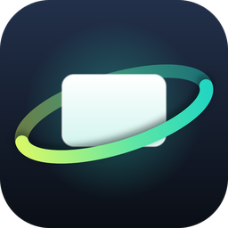

# Orbita XR



Several virtual screens floating around you with XREAL One, One Pro or 1S glasses, on Windows.
Tested mostly with a pair of 1S. It's an independent project, not affiliated with XREAL.

- 1 to 6 screens, in one row or two, curved or flat. Any of them can be in portrait.
- They stay fixed in space using the glasses' sensor. Without the sensor, the view follows the mouse.
- Travel mode (in a car or a train the screens slowly follow you through the bends), lying-down mode,
  bringing the screen you're looking at closer, and keyboard shortcuts.
- A single 1.5 MB `.exe`, no installer. Runs on Windows 10 and 11, x64 and ARM64. In English and Spanish.
- No internet: the only connection it opens is to the glasses' sensor, over the USB cable. No accounts, no
  sign-up.

## Supported glasses

| Glasses | Virtual screens | Head tracking |
| --- | --- | --- |
| XREAL One, One Pro and 1S | Yes | Yes |
| Others: XREAL Air, VITURE, Rokid, RayNeo... | In theory yes, untested | No |

**Head tracking only works with the XREAL One, One Pro and 1S.** Orbita XR reads the sensor from the USB
network those glasses create, and the Air models and other brands send it with protocols it doesn't
understand. With any other glasses the screens won't stay fixed in space when you turn your head.

The screens themselves don't depend on the model, because to Windows the glasses are just another monitor.
With other glasses, set *Tracking > Follow* to *The mouse (no sensor)*: the view turns towards whichever screen
has the mouse. If the glasses aren't detected, pick them in *Screens > Glasses*.

If you try it with other glasses, open an [issue](../../issues) and tell me how it went.

## Running it

1. Download the latest version from [Releases](../../releases/latest): `OrbitaXR-x64.exe` if your PC has an
   Intel or AMD processor, `OrbitaXR-arm64.exe` if it has a Snapdragon.
2. Double-click it. There's nothing to install. Windows will say it protected your PC, because the program
   isn't signed: click *More info* and then *Run anyway* (more on this below).
3. Connect the glasses over USB-C. In their menu: *Follow* mode (not *Anchor*), stabilizer on *Fixed*, screen
   size at 100% and ultra-wide off.
4. Press **Start**. The first time it asks to install the screen driver (see below).
5. The new screens sit above the laptop screen: move the mouse up to reach them. To come back, push the mouse
   down on any screen of the bottom row, or press Ctrl+Alt+P.
6. Without calibrating, the screens move up and down with your head and only stay fixed when you turn
   sideways. For two rows, or to keep them fixed up and down too, press **Calibrate** with the glasses on and
   follow what they show (keep still, turn right, look at the ceiling). After that, *View > Up and down*
   decides: by default one row moves up and down with you and two rows stay fixed.

The glasses must be in *Follow* mode. In *Anchor* mode they pin the image in place themselves, and since
Orbita XR already moves the screens when you turn, the turn is applied twice and you never reach the side
screens. *Field of view* is not a zoom: leave it on *auto*, or the screens slide when you turn.

Closing the window keeps Orbita XR running next to the clock (if you can't see the icon, it's under the ^
arrow). Click the icon to open the window; right-click > *Quit Orbita XR* to close it for good.

The app follows the Windows language (Spanish or English). You can change it in *Shortcuts > Language*.

### Windows and antivirus warnings

Orbita XR isn't signed: a certificate costs money every year, and even signed, Windows would keep warning
until the program had plenty of downloads. So SmartScreen treats it as an unknown program and you have to
click *More info* > *Run anyway*. If Windows 11's *Smart App Control* is on, that option doesn't appear: it
blocks unsigned programs it doesn't know, with no exceptions.

Some antivirus programs (Avast or AVG, for example) may flag it: it's a new, unsigned `.exe` that installs a
driver, captures the screen and moves the mouse. It's a false positive. If you'd rather not trust it, the code
is all here and you can build it yourself. The SHA-256 of each `.exe` is in its release notes, and in
PowerShell `Get-FileHash OrbitaXR-x64.exe` shows yours.

### The driver

Windows doesn't let a program create monitors without a display driver, so Orbita XR carries the
[Virtual Display Driver](https://github.com/VirtualDrivers/Virtual-Display-Driver) (MIT, signed) inside and
installs it the first time, with your permission: Windows asks twice, once for the app and once for the
driver. You can remove it from *Screens > Remove driver*. If you already had the Virtual Display Driver
installed, Orbita XR uses yours and leaves it as it was when it stops.

When you stop, Orbita XR disconnects its screens. If Windows turns them back on by itself while the app is
closed (the PC gets very slow when you plug in the glasses), just open Orbita XR and it turns them off; with
*Shortcuts > Open when Windows starts* it doesn't happen.

On some ARM PCs with Windows 11 24H2 that driver needs test signing turned on. If you'd rather not, choose
*Use screens I already have* in *Screens*.

### Sharpness and latency

- The glasses have about 42 pixels per degree. For text to look crisp, a virtual screen shouldn't have more
  pixels than fit: divide its width by 42 and use that as the *Size* in *View* (1280 × 720 goes with 30°,
  1600 × 900 with 38°).
- *View > Sharpness* brings back contrast at the edges of letters. Turning off ClearType in Windows helps too.
- *Tracking > Predict turns* makes up for the time the image takes to reach the glasses. If the screens
  overshoot a little and come back when you stop your head, turn it down.
- Set the virtual screens to the same refresh rate as the glasses (*Screens > Hz*, for example 90 Hz on a 1S).
  If they don't match, scrolling stutters.
- On laptops with two GPUs, Windows draws the desktop on the integrated one and the driver puts the virtual
  screens on the more powerful one. Orbita XR draws on the same GPU as the virtual screens, but Windows
  animations (opening, closing, minimizing) have to go from one GPU to the other and stutter.
  *Screens > GPU* lets you put the screens on the integrated one. The manufacturer's "dedicated GPU only"
  (MUX) mode avoids it too, at the cost of battery.

### Shortcuts

| Keys | What it does |
| --- | --- |
| Ctrl+Alt+Space | Recenter |
| Ctrl+Alt+F | Freeze the view |
| Ctrl+Alt+Z | Bring the screen you look at closer |
| Ctrl+Alt+A / D | Mouse to the screen on the left / right |
| Ctrl+Alt+M | Mouse to the screen you look at |
| Ctrl+Alt+P | Mouse to the laptop screen |
| Ctrl+Alt+W / S | Bigger / smaller screens |
| Ctrl+Alt+PgUp / PgDn | Brighter / dimmer |
| Ctrl+Alt+T | Travel mode |
| Ctrl+Alt+B | Lying-down mode |
| Ctrl+Alt+X | Start or stop |

### If something goes wrong

*About > Diagnostics* runs some tests and opens a report (`diagnostics.txt`). The log is in
`%APPDATA%\OrbitaXR\log.txt` (the previous one is kept as `log-old.txt`). Every 30 seconds it writes a `perf:`
line with frames per second, how long they take (median, p95, p99), late frames, the cost of drawing and
copying the screens, and whether the sensor ran out of data. Single hitches show up as `slow frame`. All of
it stays on your PC.

If you open an [issue](../../issues), attach both files and say which glasses and which PC you have.

## Uninstalling

1. *Screens > Remove driver*.
2. If you turned on *Shortcuts > Open when Windows starts*, turn it off.
3. Quit Orbita XR from the tray icon and delete the `.exe` and the `%APPDATA%\OrbitaXR` folder, which holds the
   settings and the log.

If you already deleted the `.exe` without removing the driver: in *Device Manager*, under *Display adapters*,
right-click *Virtual Display Driver* > *Uninstall device*, and tick the box to remove the driver too. The
`C:\VirtualDisplayDriver` folder and the registry key
`HKEY_LOCAL_MACHINE\SOFTWARE\MikeTheTech\VirtualDisplayDriver` stay behind; you can delete them by hand.

## How it works

- The virtual screens belong to the driver; Orbita XR connects them to the desktop and disconnects them with
  the Windows CCD API (no admin rights needed for that).
- Each screen is captured with *Desktop Duplication* (DXGI) and drawn with Direct3D 11 in a full screen window
  on the glasses' monitor.
- The glasses' sensor arrives over the USB network they create themselves (`169.254.2.1:52998`). The data
  format was documented by [xreal_one_driver](https://github.com/rohitsangwan01/xreal_one_driver). A
  Mahony-style complementary filter combines the gyroscope and the accelerometer, and calibration works out
  how the sensor is mounted relative to your head.

`src/core` doesn't depend on Windows: sensor parsing, fusion, screen layout, settings and tests. `src/win` is
the rest: window, capture, drawing and driver.

## Building

You need [llvm-mingw](https://github.com/mstorsjo/llvm-mingw) and bash. On Windows, download the
`ucrt-x86_64.zip` from llvm-mingw's releases, unzip it (say, to `C:\llvm-mingw`) and run this from Git Bash,
with the path written the Git Bash way:

```sh
LLVM_MINGW=/c/llvm-mingw ./build.sh
```

On Linux or WSL it's the same with the Linux build of llvm-mingw. You get `build/x86_64/OrbitaXR.exe` and
`build/aarch64/OrbitaXR.exe`, plus a copy of both in `build/release` with the names used in Releases and a
`SHA256SUMS.txt`.

The tests that don't need Windows (any g++ with C++17 will do):

```sh
g++ -std=c++17 -Isrc tests/run_tests.cpp src/core/*.cpp -o run_tests && ./run_tests
```

On Windows, `OrbitaXR.exe --selftest` does the same and also tests drawing. To try head tracking without
glasses, leave `python tests/fake_glasses.py` running in another terminal: it imitates the sensor on
`127.0.0.1:52998`, and `OrbitaXR.exe --demo --imu 127.0.0.1:52998` opens a test window that moves with it.

The icon comes from `assets/icon.svg`, plus `assets/icon-small.svg` for 32 px and below. To regenerate it you
need Pillow and a Chromium-based browser; on Windows, Edge works:

```sh
CHROME="C:\Program Files (x86)\Microsoft\Edge\Application\msedge.exe" python scripts/make_icon.py
```

## License

MIT. See [LICENSE](LICENSE) and [THIRD_PARTY_NOTICES.md](THIRD_PARTY_NOTICES.md). What changed in each
version is in [CHANGELOG.md](CHANGELOG.md).
